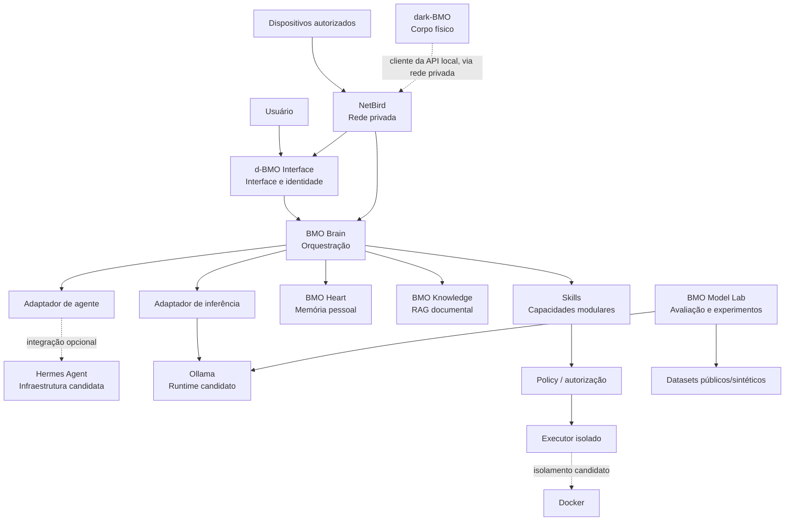

# Arquitetura do d-BMO

- **Status do documento:** proposta arquitetural.
- **Estado de implementação:** a arquitetura descrita ainda não está implementada neste repositório, salvo os registros históricos explicitamente identificados em `STATUS.md`.
- **Princípio de evolução:** monólito modular inicialmente; separar processos e serviços apenas quando houver justificativa operacional ou de segurança.

## 1. Objetivos arquiteturais

O d-BMO deve ser uma infraestrutura pessoal de IA local-first, não apenas uma interface conectada a um LLM. A arquitetura precisa permitir substituir modelos, runtimes e frameworks sem reescrever memória, conhecimento ou políticas de segurança.

Requisitos prioritários:
- dados pessoais processados localmente por padrão;
- módulos com responsabilidades e contratos explícitos;
- autorização antes de operações sensíveis;
- isolamento entre memória, documentos e ferramentas;
- rastreabilidade de fontes e operações;
- operação degradada quando módulos opcionais estiverem indisponíveis;
- implementação incremental, sem multiagentes por padrão.

## 2. Diagrama de contexto e componentes

O diagrama representa a arquitetura-alvo, não uma descrição do software atualmente disponível. NetBird deve fornecer conectividade privada; não deve expor serviços internos diretamente à internet pública.

## 3. Estados de implementação

Usar os seguintes estados em documentação, issues e futuras interfaces:

- **Implementado:** código versionado, funcionalidade executável e evidência verificável.
- **Em desenvolvimento:** existe implementação versionada, mas ainda não atende aos critérios de conclusão.
- **Planejado:** requisito ou componente definido, sem implementação comprovada.
- **Em avaliação:** tecnologia ou abordagem em comparação, sem decisão definitiva.
- **Descontinuado:** decisão explícita de não manter; registrar motivo e alternativa.

Não promover um item a “Implementado” com base apenas em intenção, teste isolado não reproduzível ou descrição em documentação.

## 4. Módulos e responsabilidades

### 4.1 d-BMO Interface

**Estado:** Planejado.

Responsável por interação conversacional, dashboard, estado do sistema, apresentação do assistente, configurações e visualização controlada de memória e fontes.

Não deve conter lógica de orquestração, acesso direto ao banco de memória ou execução arbitrária de comandos. A interface envia solicitações ao Brain por uma API local autenticada e apresenta as decisões e solicitações de autorização recebidas.

### 4.2 BMO Brain — núcleo de orquestração

**Estado:** Planejado.

Responsável por sessões, contexto de execução, planejamento simples, seleção de ferramentas, roteamento para módulos, limites de iteração, timeout, cancelamento e tratamento de erros.

O Brain define o fluxo e aplica políticas. Não deve delegar a um LLM autoridade para alterar políticas, conceder permissões ou editar livremente a memória.

Começar com um único processo e um fluxo de execução previsível. Planejamento iterativo ou múltiplos agentes só devem ser introduzidos quando testes demonstrarem benefício superior ao custo e ao risco.

### 4.3 Adaptador de agente / Hermes

**Estado:** Em avaliação.

Hermes pode fornecer infraestrutura de agente, ferramentas e skills. A integração deve ocorrer por adaptador, atrás de uma interface interna do d-BMO. O Hermes não é a identidade do d-BMO nem autoridade sobre memória e política.

Regras:
- fixar e registrar versão/revisão utilizada;
- verificar licença e avisos da versão concreta antes de incorporar ou redistribuir código;
- preferir integração externa ou adaptador a alterações no core;
- manter testes de contrato para facilitar substituição;
- não permitir que o framework contorne o Policy Gate;
- revisar permissões, tool calling, persistência e telemetria antes de habilitar recursos.

### 4.4 Adaptador de inferência / Ollama

**Estado:** Runtime testado historicamente; adaptador do d-BMO não implementado.

O Brain deve consumir uma interface independente do runtime, com operações mínimas como geração, streaming opcional, metadados do modelo e cancelamento quando suportado. O adaptador traduz essa interface para Ollama.

Não acoplar formato de prompt, nomes de modelo ou respostas proprietárias ao domínio central. Registrar modelo, tag, quantização, parâmetros e versão do runtime nos experimentos.

### 4.5 BMO Heart — memória pessoal

**Estado:** Planejado.

Armazena fatos duradouros aprovados pelo usuário, preferências, projetos e decisões. Não é histórico integral de conversa nem índice documental.

A escrita deve passar por um serviço de memória com autenticação, autorização, validação, proveniência, versionamento e auditoria. Brain, skills e modelos não recebem permissão irrestrita de escrita. A proposta inicial é que ferramentas não escrevam diretamente no armazenamento do Heart.

Separar, no mínimo:
- conteúdo da memória;
- proveniência e justificativa;
- estado (proposta, aprovada, contestada, expirada);
- versão e histórico de alteração;
- política de retenção e exclusão.

A implementação deve suportar revisão, correção, exportação e exclusão pelo usuário. Ver `SECURITY.md`.

### 4.6 BMO Knowledge — RAG documental

**Estado:** Planejado; o protótipo documental é externo ao repositório.

Responsável por ingestão, extração, normalização, chunking, indexação, recuperação e apresentação de fontes. A coleção e o escopo devem ser explícitos em cada consulta. Não misturar automaticamente coleções públicas, pessoais e profissionais.

Começar com busca textual local (SQLite FTS5) se suficiente. Adicionar embeddings e busca vetorial somente após medir limitações da busca lexical. Ver `RAG.md`.

### 4.7 BMO Model Lab

**Estado:** Protocolo documentado; smoke test QLoRA e A/B exploratório registrados em 2026-11-02 (ver `STATUS.md`). Harness e artefatos não versionados; sem avaliação de melhoria.

Responsável por inventário de modelos, datasets permitidos, protocolos de avaliação, métricas, experimentos de adaptação e versionamento de resultados. Não participa do caminho de execução normal do assistente, exceto para disponibilizar modelos explicitamente aprovados.

RAG, engenharia de prompts, fine-tuning e avaliação são técnicas distintas e devem possuir experimentos e métricas separados.

### 4.8 Skills

**Estado:** Planejado.

Skills são capacidades declarativas e versionadas. Cada skill declara entradas, saídas, ferramentas, permissões, escopo, riscos e critérios de validação. A execução passa pelo Brain e pelo Policy Gate; uma skill não concede permissões a si própria. Ver `SKILLS.md`.

### 4.9 Executor isolado / Docker

**Estado:** Planejado.

Executa tarefas de ferramentas em ambiente restrito. Containers não são uma fronteira de segurança perfeita: combinar isolamento de processo, usuário não privilegiado, limites de recursos, diretórios mínimos, rede restrita e revisão de comandos.

Não usar `--privileged`, não montar o diretório pessoal completo, não montar o armazenamento do Heart com escrita e não compartilhar o socket Docker com agentes não confiáveis.

### 4.10 NetBird

**Estado:** Configurado historicamente; conectividade atual não revalidada.

Fornece rede privada entre dispositivos autorizados. Acesso remoto deve exigir autenticação e autorização também na aplicação. Não expor Ollama, banco de dados ou executor à internet pública.

### 4.11 Corpo físico: dark-BMO

**Estado:** Hardware em montagem em repositório próprio ([resende-g/dark-BMO](https://github.com/resende-g/dark-BMO)); integração com o Brain planejada.

O dark-BMO é um aparelho portátil (ESP32-S3) que materializa o personagem d-BMO: tela com o rosto, alto-falante, microfone e botões. No "modo agente", previsto no firmware dele, o aparelho funciona como corpo remoto do assistente: envia texto ou áudio ao Brain e mostra a resposta e o estado do rosto.

Regras:
- é um **cliente** da API local do Brain, com autenticação própria, pela rede privada (NetBird). Não acessa Heart, Knowledge nem executor diretamente;
- é um dispositivo não confiável: as entradas dele passam pelas mesmas validações das demais interfaces;
- áudio do microfone é dado pessoal: não persistir por padrão (ver `SECURITY.md` §9);
- as ferramentas de RF, NFC e IR do dark-BMO (Bruce) **não são skills do BMO**. O Brain não as aciona remotamente. Qualquer integração futura exige manifesto em `SKILLS.md`, Policy Gate, escopo autorizado e confirmação humana no próprio aparelho;
- o estado do rosto (`IDLE`, `THINKING`, `ALERT` etc.) reflete o estado real do Brain, sem sugerir autonomia que o sistema não tem (ver `docs/brand/`).

## 5. Contratos e fluxo de uma solicitação

Fluxo proposto:

1. d-BMO Interface envia solicitação e identificador de sessão ao Brain.
2. Brain valida identidade, sessão, limites e política aplicável.
3. Brain obtém contexto necessário do Heart e/ou Knowledge, respeitando escopos e permissões.
4. Brain solicita inferência pelo adaptador de modelo.
5. Se houver ferramenta, o Brain valida a skill, os argumentos e as permissões.
6. Operações sensíveis aguardam autorização explícita do usuário.
7. Executor realiza a operação isolada e retorna resultado estruturado.
8. Brain valida e sintetiza a resposta, mantendo referências e proveniência.
9. d-BMO Interface apresenta resposta, fontes, ações executadas e estado de autorização.

A política deve ser aplicada fora do prompt do modelo. Instruções em documentos recuperados ou saídas de ferramentas são dados não confiáveis, nunca comandos de política.

## 6. Limites de confiança e dados

| Zona | Conteúdo | Regra |
|---|---|---|
| Interface | mensagens e ações do usuário | autenticar e validar entradas |
| Orquestração | sessão e plano de execução | sem autoridade para ampliar permissões |
| Memória | fatos pessoais aprovados | serviço de escrita controlado e auditado |
| Conhecimento | documentos e índices | escopo explícito; conteúdo tratado como não confiável |
| Inferência | prompts e respostas do modelo | saída não confiável; validar tool calls |
| Ferramentas | código e operações | menor privilégio e sandbox |
| Model Lab | datasets e adapters | dados autorizados, versionamento e avaliação |
| Rede privada | tráfego entre dispositivos | não substitui autenticação de aplicação |

## 7. Persistência e interfaces candidatas

Não fixar banco ou protocolo antes de uma necessidade demonstrada. Uma primeira implementação pode usar SQLite para metadados, estado local e FTS5, com diretórios separados para dados de memória e documentos. A camada de repositório deve evitar que SQL e detalhes do banco vazem para todos os módulos.

Interfaces conceituais:
- `InferenceProvider`: geração e metadados do modelo.
- `AgentRuntime`: execução de ciclo de agente, se adotado.
- `MemoryService`: consulta e alteração autorizada de memória.
- `KnowledgeRetriever`: busca com filtros de coleção e referências.
- `SkillRegistry`: descoberta e validação de skills.
- `PolicyEngine`: decisão de permissão e necessidade de confirmação.
- `ToolExecutor`: execução isolada e auditável.

Esses nomes são contratos conceituais, não APIs implementadas.

## 8. Restrições do hardware de referência

Configuração informada: Ubuntu 26.04.1, kernel 7.0.0-38, Ryzen 3 3300X (4c/8t), GTX 1050 Ti com 4 GB VRAM e 24 GB RAM.

Consequências:
- priorizar modelos pequenos e quantizados em testes iniciais;
- medir RAM e VRAM efetivamente ocupadas, latência e contexto;
- considerar CPU offload e impacto na velocidade;
- evitar inferir capacidade de tool calling apenas pelo tamanho do modelo;
- não assumir que fine-tuning é viável no equipamento sem validar memória, suporte e tempo;
- executar apenas um conjunto limitado de serviços simultâneos.

Esses dados são uma fotografia de referência fornecida pelo mantenedor e precisam ser revalidados antes de decisões de capacidade.

## 9. Decisões em aberto

1. API local entre d-BMO Interface e Brain.
2. Persistência inicial do Heart e política de criptografia em repouso.
3. Contrato de memória e fluxo de aprovação de novas memórias.
4. Formato e versão do manifesto de skills.
5. Se Hermes será integrado por subprocesso, API ou biblioteca.
6. Modelo e quantização padrão para inferência e embeddings.
7. Executor e perfil de sandbox adequados ao Ubuntu de referência.
8. Política de logs e retenção.
9. Compatibilidade das dependências com a licença do repositório (Apache-2.0).
10. Estratégia de backup e restauração testada.

## 10. Critérios de aceitação arquitetural

A arquitetura pode ser considerada estabelecida quando:
- responsabilidades e limites de confiança estiverem documentados;
- contratos entre módulos estiverem definidos antes das implementações;
- uma troca de runtime não exigir alteração no Heart ou Knowledge;
- nenhum agente ou skill puder alterar política ou memória diretamente;
- coleções documentais forem isoladas por padrão;
- ações sensíveis exigirem autorização e gerarem auditoria;
- os módulos opcionais puderem falhar sem corromper memória ou dados.