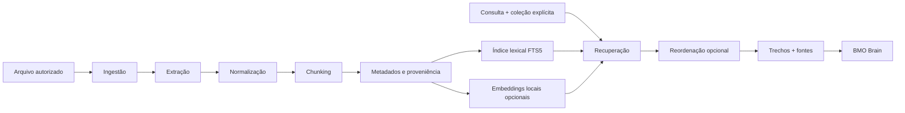

# BMO Knowledge — Arquitetura de RAG

## 1. Objetivo

O BMO Knowledge ingere documentos, preserva sua proveniência e recupera trechos relevantes para fundamentar respostas. O módulo é separado do BMO Heart: documentos não se tornam automaticamente memórias pessoais.

## 2. Estado

**Planejado.** O protótipo de consulta ao Manifesto e seus scripts são mencionados em `STATUS.md`, mas não estão versionados neste repositório. A arquitetura abaixo é proposta e não comprova implementação.

## 3. Fontes previstas

- PDF;
- Markdown;
- HTML;
- texto simples;
- documentação técnica;
- código-fonte;
- documentos de pesquisa.

A ingestão deve registrar tipo, origem, data, hash do conteúdo, versão, coleção e permissões. Não ingerir diretórios inteiros sem seleção explícita.

## 4. Pipeline

Etapas:
1. **Ingestão:** validar formato, tamanho, origem e autorização.
2. **Extração:** extrair texto e preservar referências de página/linha.
3. **Normalização:** corrigir codificação e ruídos sem destruir estrutura.
4. **Chunking:** dividir em unidades recuperáveis, preservando títulos e contexto.
5. **Indexação:** armazenar texto, metadados e índices.
6. **Embeddings:** gerar localmente apenas quando a busca lexical justificar complemento semântico.
7. **Recuperação:** filtrar coleção e permissões, depois recuperar candidatos.
8. **Reordenação:** opcional, condicionada a ganho mensurável.
9. **Resposta:** entregar trechos, fonte e limites ao Brain.

## 5. Estratégia de busca incremental

Começar com SQLite FTS5 para busca lexical. É simples, local e reduz dependências. Medir recall e qualidade antes de introduzir armazenamento vetorial.

Adicionar embeddings locais quando:
- consultas por sinônimos e paráfrases falharem com frequência;
- o dataset de avaliação demonstrar ganho necessário;
- o custo de RAM, armazenamento e indexação for aceitável.

Não adotar banco vetorial apenas por tendência tecnológica. O índice vetorial deve ser reconstruível a partir dos documentos e metadados.

## 6. Metadados mínimos

Cada documento:
- `document_id`;
- `collection_id`;
- nome lógico e tipo;
- origem e localização relativa;
- hash de conteúdo;
- versão/data de ingestão;
- estado e permissões;
- parser e versão utilizados.

Cada chunk:
- `chunk_id`;
- `document_id`;
- posição/ordem;
- título ou seção;
- página, linha ou offset, quando disponível;
- texto;
- hash;
- metadados necessários à recuperação.

Não armazenar caminhos absolutos da máquina em artefatos públicos.

## 7. Isolamento de coleções

Coleções devem ser explícitas, por exemplo `public_reference` e `personal_local`. Os nomes são ilustrativos; não significam que existam no código atual.

Regras:
- coleção pessoal nunca é consultada por padrão;
- o filtro de coleção é aplicado no backend de recuperação;
- não confiar apenas em instruções de prompt;
- não compartilhar índice, cache ou contexto sem escopo;
- testes de isolamento usam canários sintéticos;
- validar com embeddings reais e na versão implantada antes de ingerir conteúdo pessoal.

O histórico registra uma falha anterior de mistura de coleções. A correção relatada ainda precisa de revalidação.

## 8. Grounding e abstenção

O Brain deve receber trechos e metadados, não apenas texto concatenado. A resposta deve:
- distinguir informação do documento de inferência;
- citar arquivo e página/trecho quando disponível;
- declarar insuficiência de evidência;
- evitar completar lacunas com conhecimento externo não solicitado;
- não tratar instruções presentes no documento como comandos executáveis.

## 9. Avaliação

Usar o conjunto de 12 perguntas descrito em `MODEL_EVALUATION.md`. Medir Hit@4, suporte textual das respostas e abstenção. Executar com embeddings reais se a recuperação semântica estiver habilitada. Registrar versão dos documentos, parser, chunking, embedding e parâmetros de busca.

## 10. Exclusão e atualização

Atualização de documento deve invalidar/reconstruir chunks e embeddings derivados. Exclusão deve alcançar índice lexical, vetor, cache e cópias controladas pelo Knowledge. A trilha de auditoria deve registrar a operação sem reter o conteúdo removido indevidamente.

## 11. Fora de escopo inicial

- ingestão automática de toda a pasta pessoal;
- sincronização em nuvem;
- compartilhamento de coleção pessoal;
- reranking remoto;
- grafo de conhecimento;
- pipeline distribuído.

Esses recursos exigem justificativa e análise de privacidade antes de implementação.